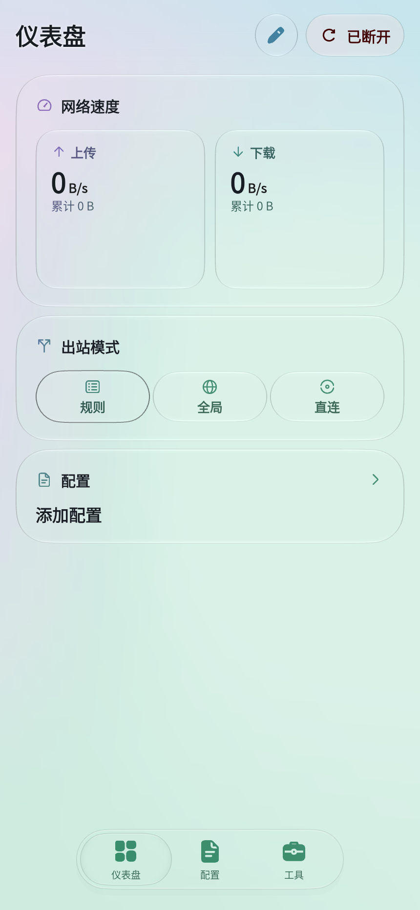
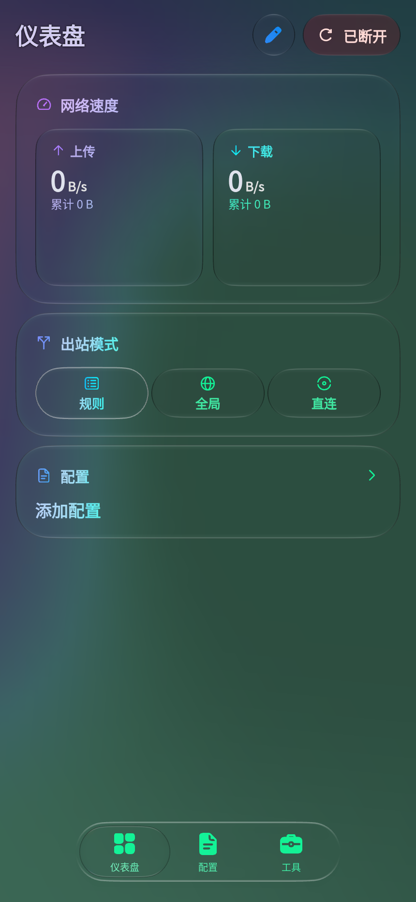

<!-- xclash-owned-readme -->
<!-- xclash-repository: IvanSolis1989/Aerove -->

# AEROVE

**简体中文** · [English](README_en.md)

AEROVE 是基于 [FlClash](https://github.com/chen08209/FlClash) 的独立分支，感谢上游作者与贡献者提供基础。保留 FlClash 的代理能力，让个性化外观、长列表浏览、配置上手和 Android 更新融入更轻盈的日常体验。

## 名字与银色折带

**AEROVE** 由 **Air（空气）+ Rove（漫游）** 组合而来，寄意轻盈地穿行于无形网络。推荐读作 **AIR-rohv**，**/ˈeə.rəʊv/**：两个音节，重音在前，末尾 **e** 不发音，不读成“艾罗维”。这是品牌创作时建议的读法，并非既有词的标准词典发音。

Logo 是炭黑底色上的银色折带：弧面向前舒展，折面收住明暗，像风留下一道柔软的路径，以抽象形态呼应流动与漫游。[名字与图标的创作过程](https://chatgpt.com/share/6ad6973c-7f5c-83ec-99f7-e00594f8490b)。

## 相比 FlClash，AEROVE 带来什么

以下以本分支记录的 FlClash `v0.9.1` 为基线。Material You、玻璃档位、连续圆角、代理组和连接监控原本由上游提供；这里介绍 Aerove 的扩展与优化。各版本的修复、待发布改动及发布范围见 [Aerove 变更记录](docs/CHANGELOG_Aerove.md)。

### 极光缓缓流动，光落在玻璃之间

柔和的色团在底图中缓缓舒展、交融，像隔着薄雾看一片流动的极光。卡片浮在颜色之上，边缘留住细光，文字与图标从背景里拾起色彩；滑过页面时，远近层次随之显露，让日常的连接界面带一点梦境般的空气感。

可以选择两种不同的光感：**标准**让正文表面只保留柔和模糊，不对正文做折射；**极致**保留正文的玻璃折射与更丰富的光学层次。两种模式的顶栏按钮和底部 Dock 都保留透明折射，让清晰的下层内容透出，顶部文字另有模糊背景衬托。实际效果随设备和图形后端而异。

- 用 1–3 种颜色生成渐变壁纸，点“换一张”改变构图，配色与构图会保存。每天本地时间 05:00 到期后，在后台静默换图，避免打断正在浏览的页面。
- 默认使用极光壁纸和极致玻璃，也可切回普通主题色并恢复原配色；玻璃强度可单独调整。深浅色可跟随系统或手动选择，高对比度和纯黑深色模式保留不透明表面。
- 将玻璃效果扩展到仪表盘、代理组、卡片、按钮、选择控件、输入框、导航、菜单、弹窗、编辑器和表单页。文字、图标和操作反馈随背景协调取色，状态提示仍有独立颜色。开关、滑条和分段选择的轨道、滑块及内部图标采用相应的玻璃与透色表现，保留拖动、键盘操作和状态反馈；无玻璃与高对比度模式保留原有回退。
- 字体从设备已有字体中选择，Aerove 不附带 MiSans。设备不支持完整玻璃效果时使用较简单的磨砂表现。

### 更适合连续浏览的界面

- 向下浏览时底部悬浮导航栏收窄，图标保持大小、文字淡出，为内容留出空间；向上滚动、回到顶部或切换页面时恢复。
- 大量代理组折叠时，只准备屏幕附近的标题；展开后再显示节点，保留展开与收起动画，减少长列表浏览时的等待。滚动条平时收起，拖动时提供位置提示。
- 代理组图标与标题中的 emoji 避免重复，当前出口可显示国家或地区旗帜；仪表盘围绕当前出口组织信息，连接、请求和 DNS 记录采用一致的文字层级与主题呈现。
- 订阅提供有效配额时，用半透明液面和比例显示已用额度，接近或超过额度时改变提示色；没有有效配额时不显示液面。

### 动态效果减少重复工作

- 多块玻璃面板共用背景处理，保持同一壁纸下的效果连贯；遮挡区域暂停不必要的动态效果。完全离屏或被视口完全裁掉的玻璃与文字跳过额外采样，重新可见后恢复，减少看不见部分的重复工作。
- 动态壁纸会根据前后台及交互状态调整更新，进入后台后暂停；返回应用时先保留已有画面再继续动画。
- 图标只提前加载少量可能出现的内容，相同节点信息供多个代理组共用；可重建的图形缓存允许系统回收，回到前台后恢复显示。这些优化减少重复工作，不承诺特定内存降幅、帧率或省电比例。

### 内置脚本，减少首次配置步骤

- 安装包内置经过完整性校验的 Smart-Config-Kit，可离线查看。新导入的普通订阅、本地文件和链接配置默认关联脚本；已有及恢复的配置、已选脚本和自定义配置保留原选择，删除脚本后不会自动重装。
- 脚本页显示来源，支持查看、编辑、复制或打开来源链接，以及手动更新；更新进行中再次操作不会重复发起。脚本更新与订阅更新分别管理。
- Android 首次配置采用独立的 VPN、系统代理、IPv6 和 DNS 默认项，减少逐项调整。DNS 自举仅使用下方四个加密地址，业务解析、分流和 fallback 交由脚本维护；已自定义 DNS 保留，仍使用上游原始默认值且没有显式覆盖选择的配置会迁移。

### 独立品牌与 Android 更新

- 银色流动折带与 `AEROVE` 显示名称贯穿应用、通知、桌面托盘、窗口和启动入口，并补充西班牙语、法语和韩语文案。
- Android 关于页发现新版本后，先阅读目标版本的更新记录或发布说明，再确认下载适配设备的 APK；长说明可滚动查看，下载由系统下载管理器处理，失败后可重试。当前提供 Android 7.0 及以上 ARM64 安装包；桌面功能因操作系统而异。
- 跟随官方上游稳定版或 `-pre.N` 标签，验证后同步，保留 Aerove 的改动；每个发布包附源码来源信息与校验文件，便于确认下载版本。版本和签名说明见下方下载章节及变更记录。

首次使用前请阅读并确认应用内免责声明：软件仅供非商业且合法用途，不提供节点、订阅或网络接入服务；订阅、配置和第三方脚本由用户与其提供者负责；软件按现状提供，不保证无错误或适用于特定用途。请以应用内免责声明全文为准。

[](https://github.com/IvanSolis1989/Aerove/releases/latest)

## 界面预览

同一配色下的浅色与深色界面，来自应用页面的实际离线渲染。[渲染来源](docs/screenshots/render-info.json)

| 浅色 | 深色 |
| --- | --- |
|  |  |

## 下载与安装

**[直接下载 Android APK](https://github.com/IvanSolis1989/Aerove/releases/latest/download/Aerove-android-arm64.apk)** · [全部版本](https://github.com/IvanSolis1989/Aerove/releases)

支持 **Android 7.0 及以上、ARM64（arm64-v8a）**。下载 APK 后允许安装该来源的应用，按系统提示安装。
更新前可在应用内备份配置。早期测试包签名不同，若提示签名冲突，请备份后卸载旧包再安装。
发布页提供 `SHA256SUMS` 和 `BUILD_INFO.json`，可核对下载文件及对应源码。
APK 使用 Aerove 固定测试签名，应用 ID 为 `com.follow.clash.dev`，与 FlClash 官方签名及 Google Play 安装包不同。

## 添加订阅与使用脚本

1. 在配置页面添加订阅链接，保存并更新配置。
2. 选中配置，确认已关联内置的 **Smart-Config-Kit** 脚本，然后启动连接。
3. 在 **进阶配置 → 脚本** 查看脚本正文和来源链接。这里可以修改、复制或打开链接，也可以手动更新脚本。

新建的普通订阅及本地配置默认关联内置脚本；已有配置与备份恢复的数据保留原来的选择。
删除脚本后不会自动补回。[查看脚本来源](https://raw.githubusercontent.com/IvanSolis1989/Smart-Config-Kit/main/FlClash/FlClash%28mihomo%29.js)。

## 主题设置

首次安装默认开启随机渐变底图与极致液态玻璃，深浅色跟随系统。用户可随时切回普通模式。

进入 **工具 → 主题 → 主题色彩**，二选一：

- **普通主题色**：使用原有主题配色，可自由调整下方液态玻璃选项。
- **随机渐变底图**：选择 **1–3 种颜色**，点击 **换一张** 改变构图；下方液态玻璃自动切到“极致”，只禁用“无”，标准和极致仍可切换。

切回普通主题色会恢复之前的主题配色，液态玻璃的“无”选项重新可选。手动选择的玻璃档位会保存。
渐变配色与当前构图会保存，重启后保留。
**自动换图策略**：每天按手机本地时间 05:00 到期，仅在应用真正进入后台时换图；若当时正在使用，就等退到后台。若 05:00 未运行，则在当天首次启动后的第一次退后台补换。启动、回到前台和截图引起的短暂非活动状态都不会当场换图；不会为了换图唤醒已关闭的应用。手动“换一张”立即生效，并计入当前日周期。版本变化见 [变更记录](docs/CHANGELOG_Aerove.md)。
深浅色默认**跟随系统**，也可在页面顶部指定浅色或深色。高对比度、深色纯黑模式使用不透明表面。

## DNS 默认设置

内置脚本提供分流与防泄漏 DNS 配置。客户端不追加系统 DNS，启动自举仅使用以下四个加密地址：

```yaml
default-nameserver:
  - https://223.5.5.5/dns-query
  - https://223.6.6.6/dns-query
  - https://8.8.8.8/dns-query
  - https://1.1.1.1/dns-query
```

业务 DNS、分域策略及 fallback 由脚本配置。恢复默认也使用这套方案。
VPN 系统代理、VPN/核心 IPv6、应用绕过默认关闭，DNS 劫持默认开启。
首次 Android 配置中 VPN 开关开启、应用访问控制关闭，默认规则模式、统一延迟和 TCP 并发开启；连接保持空闲/间隔为 30/15 秒。启动连接仍需用户操作。
具体取值见 [网络默认配置](docs/network-defaults.md)。

## 在 Cloudflare 部署 SubStore

以下使用 [sub-store-cloudflare](https://github.com/realchendahuang/sub-store-cloudflare) 新建部署，前端与后端一起部署到自己的 Cloudflare 账号。
准备 Cloudflare、GitHub 或 GitLab 账号，以及自己的订阅链接。

### 1. 准备两个随机 Token

用密码管理器生成两个不同、各至少 32 字节的随机值并保存，分别作为管理 Token 和下载 Token。
安装了 Node.js 的电脑也可运行：

```sh
node -e "const{randomBytes:r}=require('node:crypto');console.log(r(32).toString('base64url'));console.log(r(32).toString('base64url'))"
```

### 2. 部署到 Cloudflare

点击 **[部署到 Cloudflare](https://deploy.workers.cloudflare.com/?url=https://github.com/realchendahuang/sub-store-cloudflare)**，登录并按提示导入仓库：

| 项目 | 填写内容 |
| --- | --- |
| Worker 名称 | 自定，例如 `sub-store-cloudflare` |
| D1 数据库 | 新建数据库 |
| `SUB_STORE_ADMIN_TOKEN` | 第一个随机值，作为 Secret 保存 |
| `SUB_STORE_PUBLIC_DOWNLOAD_TOKEN` | 第二个随机值，作为 Secret 保存 |
| 构建命令 | `pnpm run build` |
| 部署命令 | `pnpm run deploy` |

等待构建和部署成功，保存 Cloudflare 显示的 Worker 地址。

### 3. 打开管理页面并添加订阅

在 Worker 地址后加上 `/?token=<管理Token>` 打开管理页面，例如：

```text
https://sub-store-cloudflare.<你的子域>.workers.dev/?token=<管理Token>
```

添加订阅源（Source），填入自己的订阅链接并保存；再进入默认的 `Daily` 组合订阅（Collection），确认已包含需要的订阅源。

### 4. 导入 Aerove

在组合订阅卡片复制 **Mihomo / Clash Meta** 格式的下载链接，在 Aerove 配置页面添加该链接。
下载链接使用下载 Token；管理 Token 只用于管理页面。确认 Aerove 能更新并显示节点，即完成接入。
导入后保留 Aerove 内置的 Smart-Config-Kit 脚本与 DNS 默认设置，分流脚本在 Aerove 内执行。
两个 Token 和完整订阅链接都应私下保存。

部署问题可对照该项目的 [快速开始](https://github.com/realchendahuang/sub-store-cloudflare/blob/main/docs/quick-start.md)。

## 问题反馈

请在 [Issues](https://github.com/IvanSolis1989/Aerove/issues) 提供应用版本、Android 版本和复现步骤。
主题问题请附上深浅色模式、配色和截图；提交日志前移除订阅链接及节点凭据。

## 上游同步与版本发布

本仓库每小时检查官方上游发布标签，验证后同步；定时任务可能延迟。上游版本后加 `-X` 作为 Aerove 显示版本，完整发布编号和修复范围见 [Aerove 变更记录](docs/CHANGELOG_Aerove.md)，当前下载以 [Releases](https://github.com/IvanSolis1989/Aerove/releases/latest) 为准。维护与构建规则见 [上游同步说明](docs/upstream-sync.md)。

[GPL-3.0](LICENSE)
