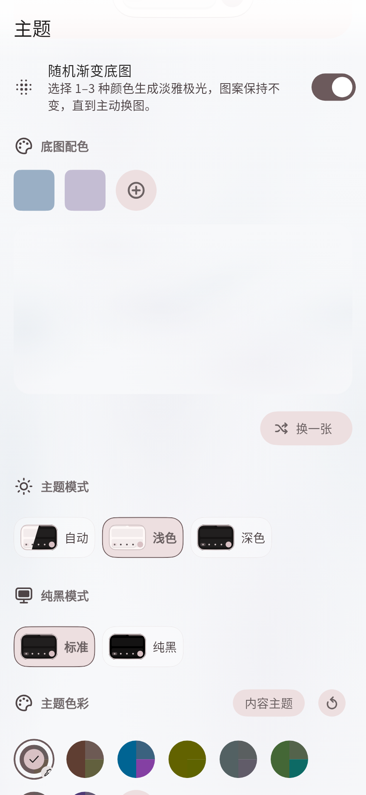

<!-- xclash-owned-readme -->
<!-- xclash-repository: IvanSolis1989/XClash -->

# XClash

**简体中文** · [English](README_en.md)

[](https://github.com/IvanSolis1989/XClash/releases/latest)

## 下载与安装

**[直接下载 Android APK](https://github.com/IvanSolis1989/XClash/releases/latest/download/XClash-android-arm64.apk)** · [全部版本](https://github.com/IvanSolis1989/XClash/releases)

支持 **Android 7.0 及以上、ARM64（arm64-v8a）**。下载 APK 后允许安装该来源的应用，按系统提示安装。
更新前可在应用内备份配置。早期测试包签名不同，若提示签名冲突，请备份后卸载旧包再安装。
发布页提供 `SHA256SUMS` 和 `BUILD_INFO.json`，可核对下载文件及对应源码。

## 添加订阅与使用脚本

1. 在配置页面添加订阅链接，保存并更新配置。
2. 选中配置，确认已关联内置的 **Smart-Config-Kit** 脚本，然后启动连接。
3. 在 **进阶配置 → 脚本** 查看脚本正文和来源链接。这里可以修改、复制或打开链接，也可以手动更新脚本。

新建的普通订阅及本地配置默认关联内置脚本；已有配置与备份恢复的数据保留原来的选择。
删除脚本后不会自动补回。脚本来源：

```text
https://raw.githubusercontent.com/IvanSolis1989/Smart-Config-Kit/main/FlClash/FlClash%28mihomo%29.js
```

## 主题设置

进入 **工具 → 主题 → 主题色彩**，二选一：

- **普通主题色**：使用原有主题配色，可自由调整下方液态玻璃选项。
- **随机渐变底图**：选择 **1–3 种颜色**，点击 **换一张** 改变构图；下方液态玻璃自动切到“极致”，只禁用“无”，标准和极致仍可切换。

切回普通主题色会恢复之前的主题配色，液态玻璃的“无”选项重新可选。手动选择的玻璃档位会保存。
渐变配色与构图也会保存，重启后保持不变。
深浅色默认**跟随系统**，也可在页面顶部指定浅色或深色。高对比度、深色纯黑模式使用不透明表面。

<p align="center">
  
</p>

*界面预览由 Flutter 测试渲染。*

## DNS 默认设置

内置脚本提供分流与防泄漏 DNS 配置。客户端不追加系统 DNS，启动自举仅使用以下四个加密地址：

```yaml
default-nameserver:
  - https://223.5.5.5/dns-query
  - https://223.6.6.6/dns-query
  - https://8.8.8.8/dns-query
  - https://1.1.1.1/dns-query
```

业务 DNS、分域策略及 fallback 由脚本配置。恢复默认也使用这套方案。
VPN 系统代理、VPN/核心 IPv6、应用绕过默认关闭，DNS 劫持默认开启。
具体取值见 [网络默认配置](docs/network-defaults.md)。

## 在 Cloudflare 部署 SubStore

以下使用 [sub-store-cloudflare](https://github.com/realchendahuang/sub-store-cloudflare) 新建部署，前端与后端一起部署到自己的 Cloudflare 账号。
准备 Cloudflare、GitHub 或 GitLab 账号，以及自己的订阅链接。

### 1. 准备两个随机 Token

用密码管理器生成两个不同、各至少 32 字节的随机值并保存，分别作为管理 Token 和下载 Token。
安装了 Node.js 的电脑也可运行：

```sh
node -e "const{randomBytes:r}=require('node:crypto');console.log(r(32).toString('base64url'));console.log(r(32).toString('base64url'))"
```

### 2. 部署到 Cloudflare

点击 **[部署到 Cloudflare](https://deploy.workers.cloudflare.com/?url=https://github.com/realchendahuang/sub-store-cloudflare)**，登录并按提示导入仓库：

| 项目 | 填写内容 |
| --- | --- |
| Worker 名称 | 自定，例如 `sub-store-cloudflare` |
| D1 数据库 | 新建数据库 |
| `SUB_STORE_ADMIN_TOKEN` | 第一个随机值，作为 Secret 保存 |
| `SUB_STORE_PUBLIC_DOWNLOAD_TOKEN` | 第二个随机值，作为 Secret 保存 |
| 构建命令 | `pnpm run build` |
| 部署命令 | `pnpm run deploy` |

等待构建和部署成功，保存 Cloudflare 显示的 Worker 地址。

### 3. 打开管理页面并添加订阅

在 Worker 地址后加上 `/?token=<管理Token>` 打开管理页面，例如：

```text
https://sub-store-cloudflare.<你的子域>.workers.dev/?token=<管理Token>
```

添加订阅源（Source），填入自己的订阅链接并保存；再进入默认的 `Daily` 组合订阅（Collection），确认已包含需要的订阅源。

### 4. 导入 XClash

在组合订阅卡片复制 **Mihomo / Clash Meta** 格式的下载链接，在 XClash 配置页面添加该链接。
下载链接使用下载 Token；管理 Token 只用于管理页面。确认 XClash 能更新并显示节点，即完成接入。
导入后保留 XClash 内置的 Smart-Config-Kit 脚本与 DNS 默认设置，分流脚本在 XClash 内执行。
两个 Token 和完整订阅链接都应私下保存。

部署问题可对照该项目的 [快速开始](https://github.com/realchendahuang/sub-store-cloudflare/blob/main/docs/quick-start.md)。

## 版本更新

本仓库**每小时自动检查一次上游更新**，选取所有分支可达的最高版本标签，包含预发布。
通过验证后构建并发布 APK，版本号为“上游版本号 + `-X`”，例如 `0.9.1-pre.4-X`。
GitHub 定时任务可能延迟；实际可下载版本以 [Releases](https://github.com/IvanSolis1989/XClash/releases/latest) 为准。
只修改 README 等文档不会触发 APK 构建，也不会取消正在进行的构建。

## 问题反馈

请在 [Issues](https://github.com/IvanSolis1989/XClash/issues) 提供应用版本、Android 版本和复现步骤。
主题问题请附上深浅色模式、配色和截图；提交日志前移除订阅链接及节点凭据。

[GPL-3.0](LICENSE)
