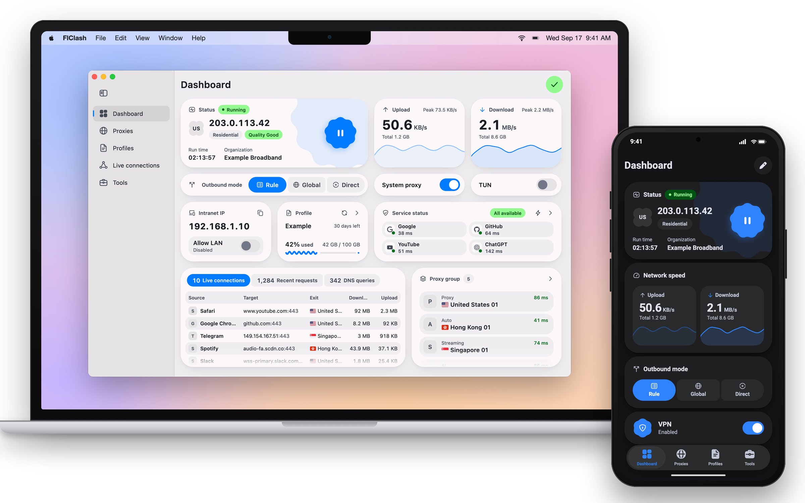

<div align="center">


# XClash

[XClash](https://github.com/IvanSolis1989/XClash) 是基于 chen08209 的
[FlClash](https://github.com/chen08209/FlClash) 开发的 [GPL-3.0](LICENSE) 分支。
现阶段优先开发 Android 版，视觉方向为淡雅极光与玻璃质感，保留上游作者署名和许可声明。
本阶段保留现有 Android 包 ID 以维持兼容性。

在 **工具 → 主题 → 随机渐变底图** 中选择 1–3 色，点击“换一张”改变图案。
配色和图案随配置保存；关闭后恢复普通主题，高对比度或深色纯黑模式使用实色表面。
[Android 构建记录](https://github.com/IvanSolis1989/XClash/actions/workflows/xclash-android.yaml)
· [上游自动同步说明](docs/upstream-sync.md)

[English](README.md) · **简体中文**

[](https://github.com/IvanSolis1989/XClash/releases/latest)
[](https://github.com/IvanSolis1989/XClash/releases)
[](LICENSE)
[](https://t.me/FlClash)

[仓库](https://github.com/IvanSolis1989/XClash) · [下载](#下载) · [更新日志](CHANGELOG.md) · [从源码构建](#从源码构建)

</div>

以下保留上游截图和架构文档；下载入口均指向本分支。

<p align="center">
  <picture>
    <source media="(prefers-color-scheme: dark)" srcset="snapshots/preview-dark.png">
    
  </picture>
</p>

## 功能

- **本分支优先支持 Android**；上游还支持 Windows、macOS 和 Linux。
- **mihomo（Clash.Meta）内核**：规则分流、代理组、延迟测试、系统代理与 TUN 模式。
- **配置管理**：通过订阅链接或文件导入配置，内置编辑器，支持覆写脚本以及自定义规则、代理和代理组。
- **实时查看**连接、请求、DNS 查询和日志。
- **Material You 设计，融合 Apple 式交互**：支持动态取色、浅色与深色主题，连续曲率圆角，弹出面板可在几档高度间吸附，布局随屏幕从手机到桌面自适应。
- **备份与恢复**：通过 WebDAV 或本地文件。
- **平台细节**：Android 上有快捷设置磁贴、分应用代理和 Android TV 支持；桌面端有托盘菜单和全局快捷键。
- **开源无广告**，以 GPL-3.0 协议发布。

## 下载

从 [XClash Releases](https://github.com/IvanSolis1989/XClash/releases/latest) 获取本分支发布版本，或直接下载 [Android ARM64 APK](https://github.com/IvanSolis1989/XClash/releases/latest/download/XClash-android-arm64.apk)。

目前仅发布 Android `arm64-v8a` APK；其他架构和桌面平台暂未发布。
当前为固定测试签名的 Android 预览版，尚未完成真机验收。
Actions 页面仅用于查看构建记录。

<p>
  <a href="https://github.com/IvanSolis1989/XClash/releases/latest"></a>
</p>

## 使用

**通过链接导入配置。** 打开下面格式的链接，即可把订阅导入 FlClash。`clashmeta://` 和 `flclash://` 开头的链接同样可用。

```text
clash://install-config?url=<经过 URL 编码的订阅链接>
```

**Android 自动化。** Tasker、MacroDroid 等应用可以用下面的 Action 启动 Activity，从而启动、停止或切换代理：

```text
com.follow.clash.action.START
com.follow.clash.action.STOP
com.follow.clash.action.TOGGLE
```

在电脑上也可以通过 adb 触发：

```bash
adb shell am start -a com.follow.clash.action.TOGGLE
```

## 从源码构建

需要 [Flutter](https://docs.flutter.dev/get-started/install) 3.47（正式版构建使用 3.47.6）、[Go](https://go.dev/dl/) 1.27，
以及通过 rustup 安装的 [Rust](https://rustup.rs/)。桌面端需要在对应系统上构建，Android 在任意系统上都能构建。

```bash
git clone --recursive https://github.com/IvanSolis1989/XClash.git
cd XClash
flutter pub get
dart setup.dart android   # 或 windows、macos、linux
```

安装包输出到 `dist/`。Go 内核和 Rust 库会在 Flutter 构建过程中一并编译。

| 平台 | 额外依赖 |
| --- | --- |
| Android | 带 NDK 的 Android SDK。加上 `--arch arm64` 可以只构建单个 ABI。 |
| Windows | 编译内核用的 GCC（MinGW-w64），以及打包安装程序用的 [Inno Setup](https://jrsoftware.org/isinfo.php) 6。 |
| macOS | Xcode 与 Node.js。脚本会通过 npm 安装 `appdmg`。 |
| Linux | Debian 或 Ubuntu。脚本会用 apt 安装构建所需的软件包，并下载 `appimagetool`。 |

其余选项可以运行 `dart setup.dart --help` 查看，例如用 `--targets` 只构建部分安装包格式。

## 支持

欢迎给本分支点 Star；Bug 与功能建议请提交到 [XClash Issues](https://github.com/IvanSolis1989/XClash/issues)。

上游社区：[FlClash Telegram 频道](https://t.me/FlClash)。

<a href="https://star-history.com/#IvanSolis1989/XClash&Date">
  <picture>
    <source media="(prefers-color-scheme: dark)" srcset="https://api.star-history.com/svg?repos=IvanSolis1989/XClash&type=Date&theme=dark">
    
  </picture>
</a>

## 许可证

FlClash 以 [GPL-3.0 协议](LICENSE)发布。
