<!-- xclash-owned-readme -->
<!-- xclash-repository: IvanSolis1989/Aerove -->
# AEROVE

English · [简体中文](README.zh-CN.md)

An independently maintained proxy client with two products in one repository.

## AEROVE Standard

Flutter + Mihomo; Android, Windows, macOS and Linux.

**Source:** [apps/aerove](../../apps/aerove/) · **Release:** [Stable APK](https://github.com/IvanSolis1989/Aerove/releases/latest/download/Aerove-android-arm64.apk)

<!-- aerove:releases:start -->
- **Stable** · [0.13.0](https://github.com/IvanSolis1989/Aerove/releases/tag/v0.13.0%2B2026102340) · Build `2026102340` · [Android ARM64 APK](https://github.com/IvanSolis1989/Aerove/releases/download/v0.13.0%2B2026102340/Aerove-android-arm64.apk)
- **Public preview** · [0.13.0-beta.4](https://github.com/IvanSolis1989/Aerove/releases/tag/v0.13.0-beta.4%2B2026102336) · Build `2026102336` · [Android ARM64 APK](https://github.com/IvanSolis1989/Aerove/releases/download/v0.13.0-beta.4%2B2026102336/Aerove-android-arm64.apk)
<!-- aerove:releases:end -->

## AEROVE Lite

Shared Flutter UI + native Android integration + meow-rs (in development); Android 13 / API 33+.

**Source:** [apps/aerove-lite](../../apps/aerove-lite/) · **Release:** No first public release yet. Test candidates are not release or device acceptance.

Shared UI, interactions and client features must remain identical in both directions. Only capabilities proven unsupported
by the pinned Rust engine may be deferred. Keep product versions, packages, signing identities and update feeds separate.

- [Standard preview releases](https://github.com/IvanSolis1989/Aerove/releases) (separate from stable latest)
- [Telegram channel](https://t.me/IvanSolis89) · [Community group](https://t.me/Olympus_Habitue)
- [Documentation](../../docs/README.md)
- [UI, function and performance contract](../../docs/shared/UI_CONTRACT.md)
- [AEROVE changelog](../../docs/aerove/CHANGELOG.md)
- [Workspace and document policy](../../docs/development/REPOSITORY_LAYOUT.md)
- [Development commands](../../.agents/commands.md)

## Interface preview

<!-- aerove:showcase:start -->
Twelve combinations of the Standard development interface. Click an image for full size. Actual Flutter widgets rendered offline with no profile or connection; not Android device or Lite acceptance.

### Solid

**Classic monochrome**

<a href="../../docs/assets/screenshots/showcase/solid-classic-light.png">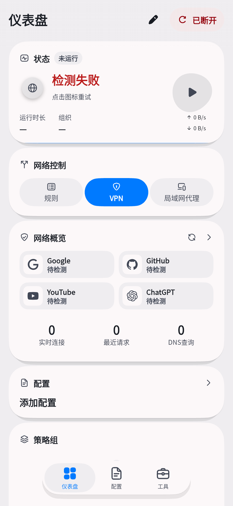</a> <a href="../../docs/assets/screenshots/showcase/solid-classic-dark.png">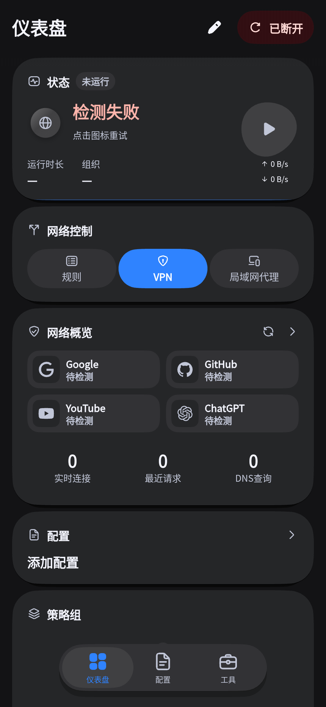</a>

**Aurora**

<a href="../../docs/assets/screenshots/showcase/solid-aurora-light.png">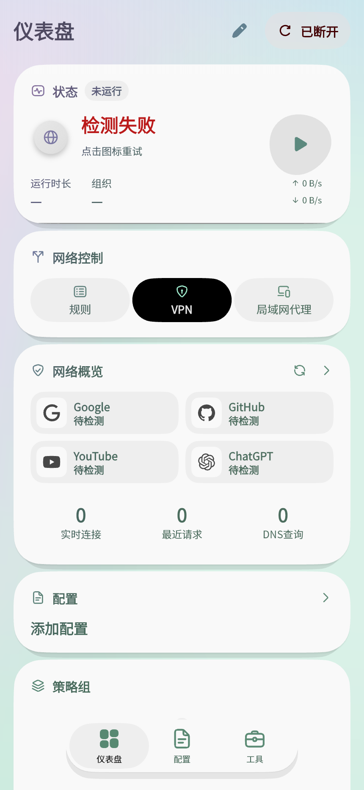</a> <a href="../../docs/assets/screenshots/showcase/solid-aurora-dark.png">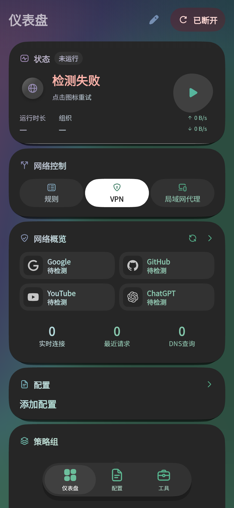</a>

### Soft frost

**Classic monochrome**

<a href="../../docs/assets/screenshots/showcase/frost-classic-light.png">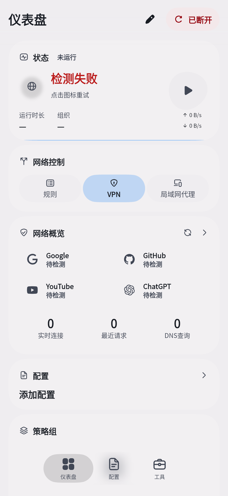</a> <a href="../../docs/assets/screenshots/showcase/frost-classic-dark.png">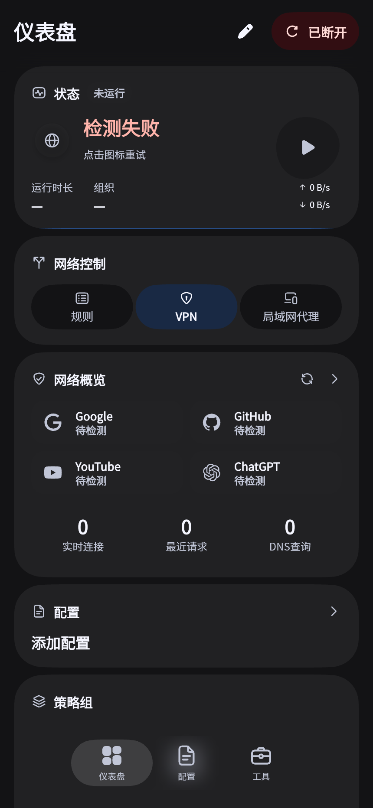</a>

**Aurora**

<a href="../../docs/assets/screenshots/showcase/frost-aurora-light.png">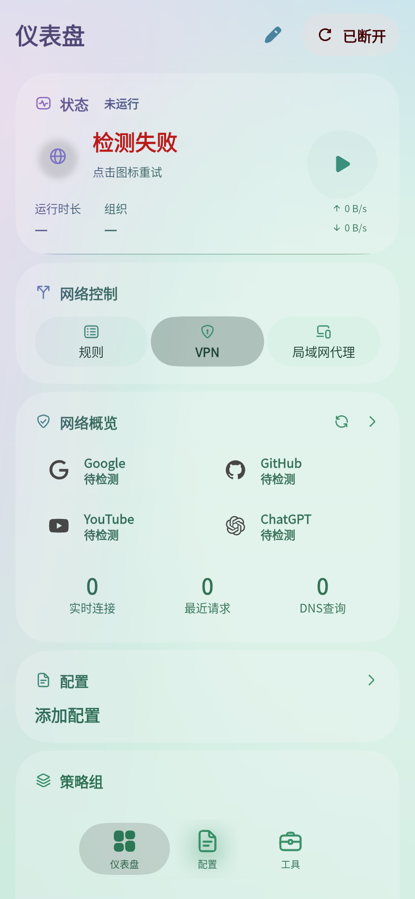</a> <a href="../../docs/assets/screenshots/showcase/frost-aurora-dark.png">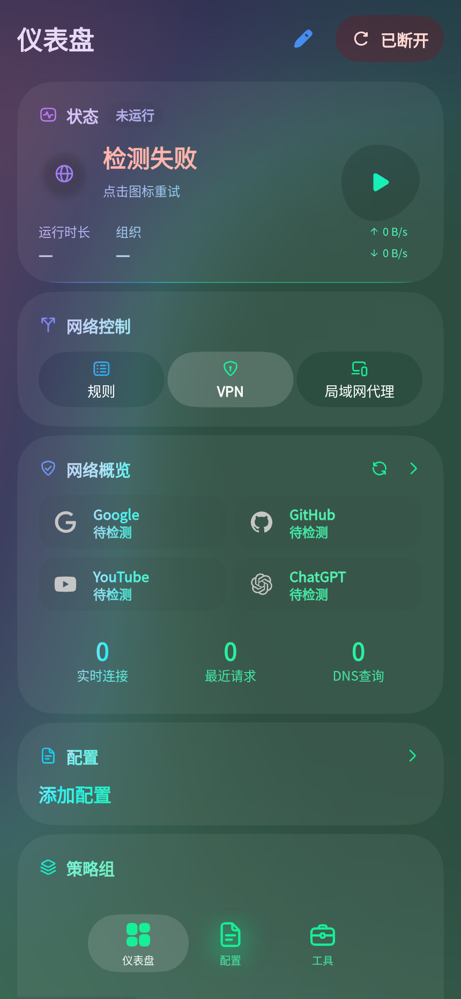</a>

### Liquid clear

**Classic monochrome**

<a href="../../docs/assets/screenshots/showcase/clear-classic-light.png">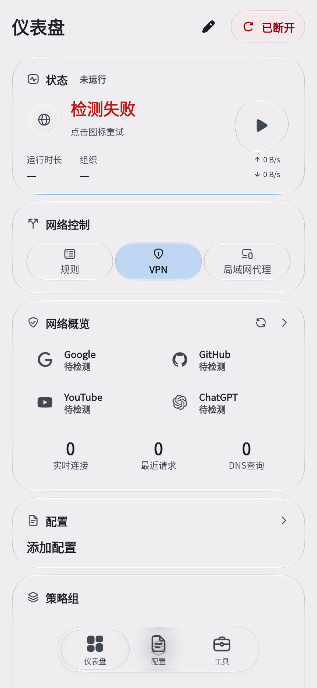</a> <a href="../../docs/assets/screenshots/showcase/clear-classic-dark.png">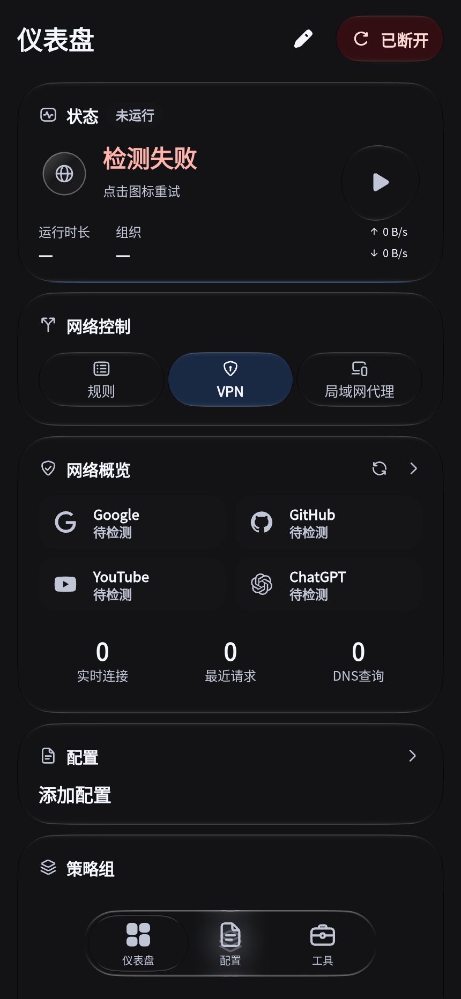</a>

**Aurora**

<a href="../../docs/assets/screenshots/showcase/clear-aurora-light.png">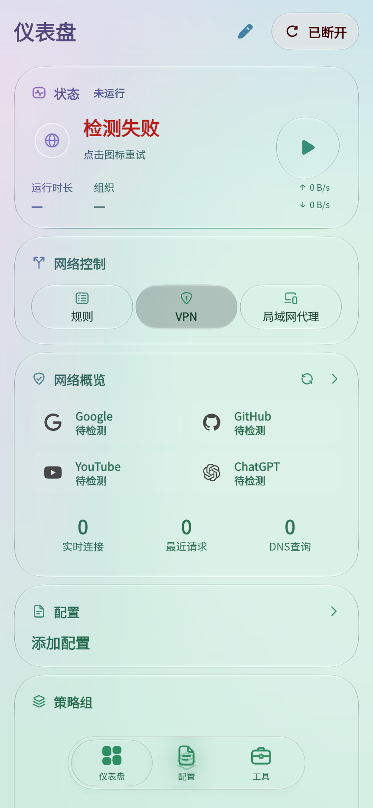</a> <a href="../../docs/assets/screenshots/showcase/clear-aurora-dark.png">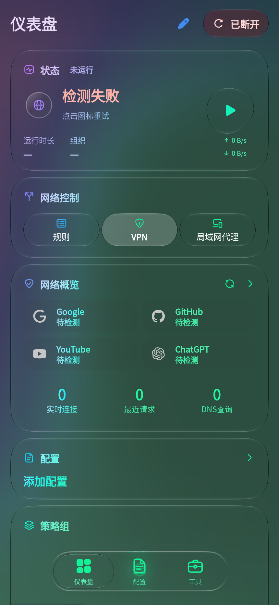</a>

Source: [`03ee44322fcc81c2348e30f8f312d6b9a1931861`](https://github.com/IvanSolis1989/Aerove/commit/03ee44322fcc81c2348e30f8f312d6b9a1931861) · [Render provenance](../../docs/assets/screenshots/showcase/render-info.json)
<!-- aerove:showcase:end -->

The historical codebase comes from [FlClash](https://github.com/chen08209/FlClash); original attribution and licenses are
preserved. AEROVE now owns its architecture and release process. Mihomo and meow-rs are independently pinned upstreams. Lite has no public release yet.
This repository uses [GPL-3.0](../../LICENSE); dependencies retain their original notices.

---

Next: [Documentation](../../docs/README.md) · [Changelog](../../docs/aerove/CHANGELOG.md)

## Get started

1. Select a published Standard build and read its release notes. Back up your data before switching builds.
2. Import a configuration or subscription that you are authorized to use. AEROVE does not supply proxy nodes or subscription services.
3. Select an outbound and routing mode, then connect. Android asks for VPN permission on first use.

Routing, DNS, application rules and regional rule sets are configurable technical features. Their presence is not a promise that a service is reachable in any country or network. Review [network behavior](../../docs/aerove/network-defaults.md) and [defaults](../../docs/aerove/defaults.md) before changing them.

## Responsible use and warranty

Use AEROVE only where you have authorization and in accordance with applicable law and service terms. You are responsible for the configurations, endpoints and third-party services you choose. Availability, performance, anonymity and suitability for a particular purpose are not guaranteed. No statement here promises that all data stays on-device or that third-party services collect no data.

The software is provided under [GPL-3.0](../../LICENSE), including its warranty disclaimer. This notice does not restrict rights granted by that license or replace applicable upstream license/NOTICE and source-distribution obligations. See [sources and acknowledgements](../../docs/development/upstreams.md#开源来源与鸣谢).
