<!-- xclash-owned-readme -->
<!-- xclash-repository: IvanSolis1989/Aerove -->
# AEROVE

[Project home](../../README.md) / English

[简体中文](../../README.md) · English

An independently maintained proxy client with two products in one repository.

## AEROVE Standard

Flutter + Mihomo; Android, Windows, macOS and Linux.

**Source:** [apps/aerove](../../apps/aerove/) · **Release:** [Stable APK](https://github.com/IvanSolis1989/Aerove/releases/latest/download/Aerove-android-arm64.apk)

<!-- aerove:releases:start -->
- **Stable** · [0.11.0](https://github.com/IvanSolis1989/Aerove/releases/tag/v0.11.0%2B2026102298) · Build `2026102298` · [Android ARM64 APK](https://github.com/IvanSolis1989/Aerove/releases/download/v0.11.0%2B2026102298/Aerove-android-arm64.apk)
- **Public preview** · [0.11.0-beta.17](https://github.com/IvanSolis1989/Aerove/releases/tag/v0.11.0-beta.17%2B2026102294) · Build `2026102294` · [Android ARM64 APK](https://github.com/IvanSolis1989/Aerove/releases/download/v0.11.0-beta.17%2B2026102294/Aerove-android-arm64.apk)
<!-- aerove:releases:end -->

## AEROVE Lite

Native Android + meow-rs (in development); Android 13+.

**Source:** [apps/aerove-lite](../../apps/aerove-lite/) · **Release:** In development and validation

Shared UI, interactions and client features must remain identical in both directions. Only capabilities proven unsupported
by the pinned Rust engine may be deferred. Keep product versions, packages, signing identities and update feeds separate.

- [Standard preview releases](https://github.com/IvanSolis1989/Aerove/releases) (separate from stable latest)
- [Telegram channel](https://t.me/IvanSolis89) · [Community group](https://t.me/Olympus_Habitue)
- [Documentation](../README.md)
- [UI, function and performance contract](../shared/UI_CONTRACT.md)
- [AEROVE changelog](../aerove/CHANGELOG.md)
- [Workspace and document policy](../development/REPOSITORY_LAYOUT.md)
- [Development commands](../../.agents/commands.md)

## Interface preview

<!-- aerove:showcase:start -->
Twelve combinations of the Standard development interface. Click an image for full size. Actual Flutter widgets rendered offline with no profile or connection; not Android device or Lite acceptance.

### Solid

**Classic monochrome**

<a href="../../docs/assets/screenshots/showcase/solid-classic-light.png">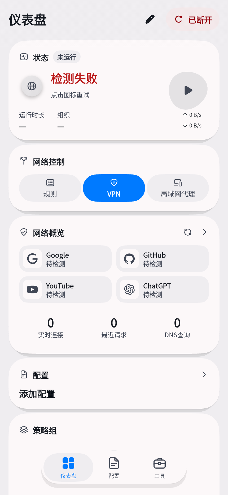</a> <a href="../../docs/assets/screenshots/showcase/solid-classic-dark.png">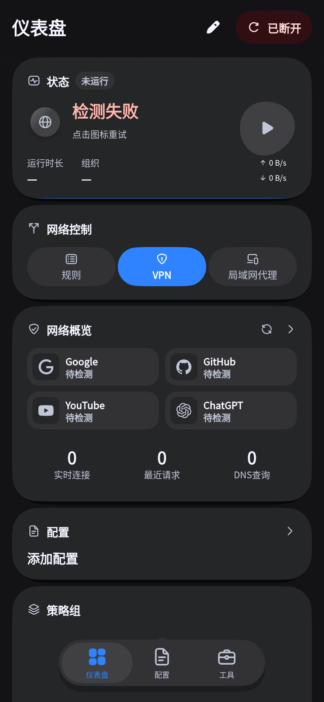</a>

**Aurora**

<a href="../../docs/assets/screenshots/showcase/solid-aurora-light.png">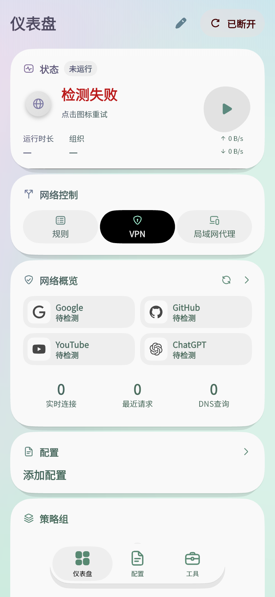</a> <a href="../../docs/assets/screenshots/showcase/solid-aurora-dark.png">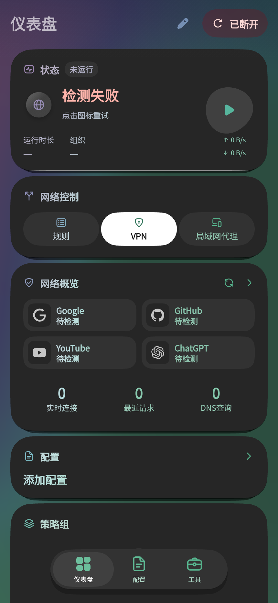</a>

### Soft frost

**Classic monochrome**

<a href="../../docs/assets/screenshots/showcase/frost-classic-light.png">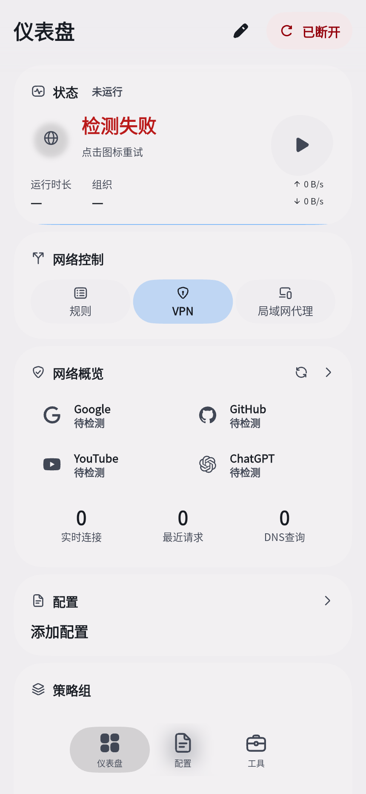</a> <a href="../../docs/assets/screenshots/showcase/frost-classic-dark.png">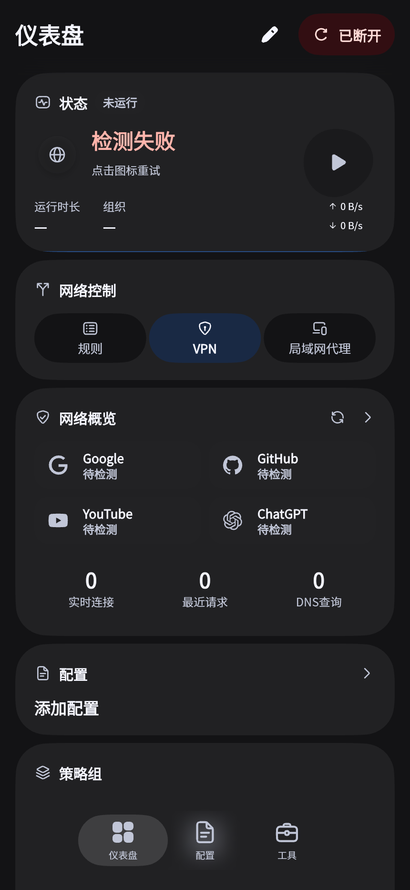</a>

**Aurora**

<a href="../../docs/assets/screenshots/showcase/frost-aurora-light.png">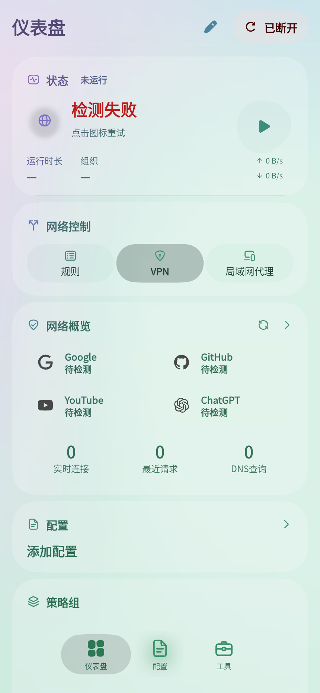</a> <a href="../../docs/assets/screenshots/showcase/frost-aurora-dark.png">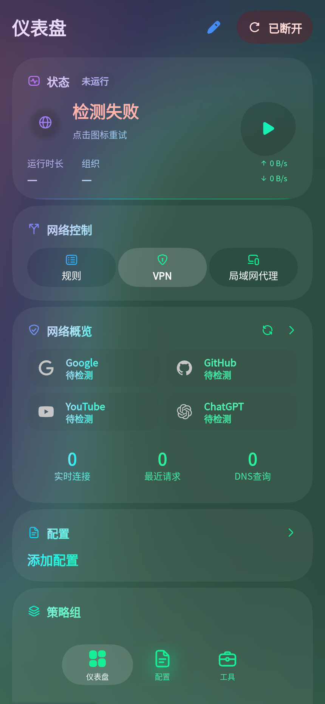</a>

### Liquid clear

**Classic monochrome**

<a href="../../docs/assets/screenshots/showcase/clear-classic-light.png">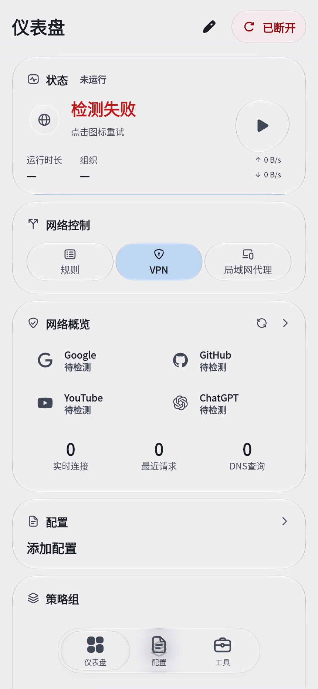</a> <a href="../../docs/assets/screenshots/showcase/clear-classic-dark.png">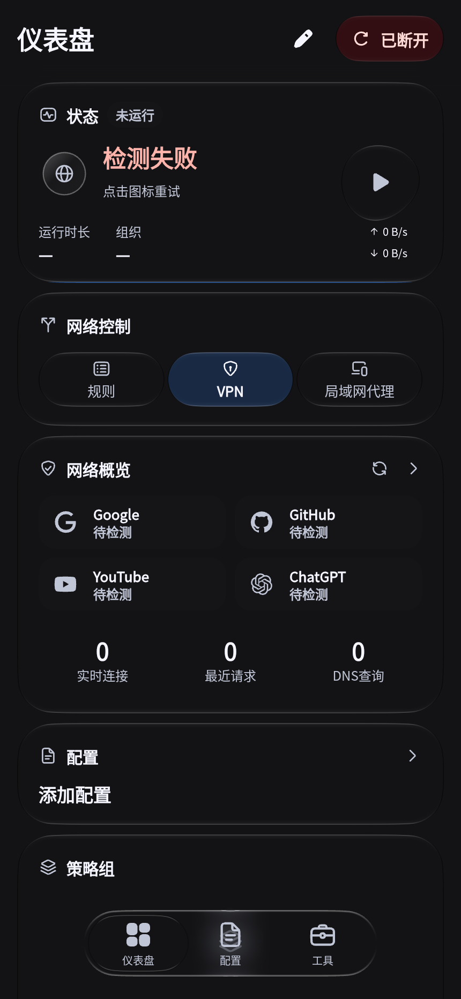</a>

**Aurora**

<a href="../../docs/assets/screenshots/showcase/clear-aurora-light.png">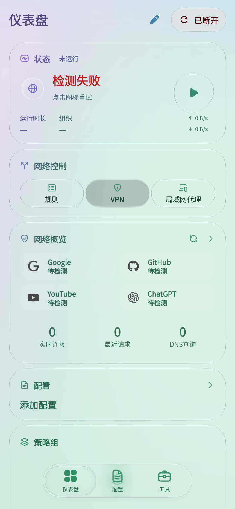</a> <a href="../../docs/assets/screenshots/showcase/clear-aurora-dark.png">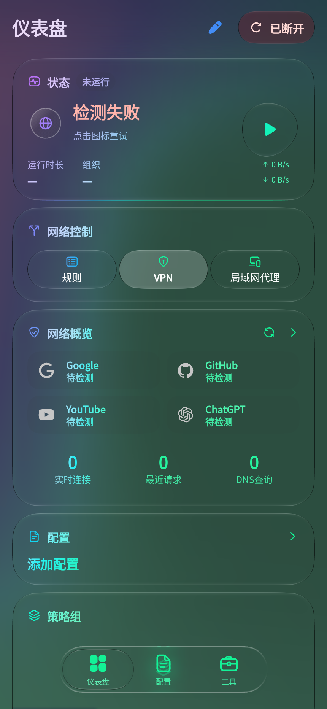</a>

Source: [`985b7751b384132f9e5d5b589b62133edabf817e`](https://github.com/IvanSolis1989/Aerove/commit/985b7751b384132f9e5d5b589b62133edabf817e) · [Render provenance](../../docs/assets/screenshots/showcase/render-info.json)
<!-- aerove:showcase:end -->

The historical codebase comes from [FlClash](https://github.com/chen08209/FlClash); original attribution and licenses are
preserved. AEROVE now owns its architecture and release process. Mihomo and meow-rs are independently pinned upstreams. Lite has no public release yet.
This repository uses [GPL-3.0](../../LICENSE); dependencies retain their original notices.

---

Next: [Documentation](../README.md) · [Changelog](../aerove/CHANGELOG.md)
