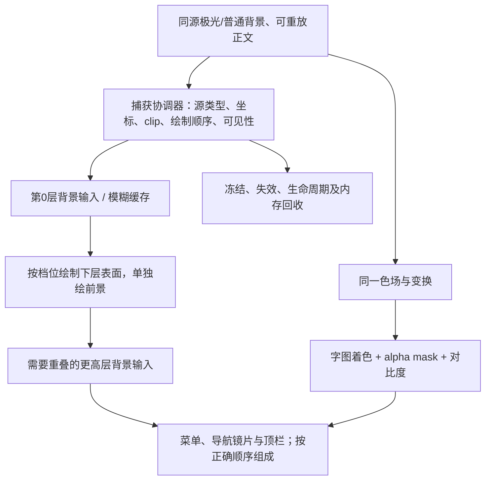

[文档](../../README.md) / [技术研究](../README.md)

# AEROVE Lite Android 原生渲染迁移只读审计

阅读边界：本页保留固定来源、当时判断与未闭环记录，不能代替生产规格或实际验收。现行 Lite 为原生 Android + meow-rs、最低 API 33；共同界面和客户端功能以[双向契约](../../shared/UI_CONTRACT.md)为准，仅固定 Rust 核心源码证明不支持的能力可暂缓。

本页目录：[结论与历史方向](#结论与历史方向) · [固定视觉基线](#固定视觉基线) · [原生能力映射](#原生能力映射) · [历史系统范围与技术路线](#历史系统范围与技术路线) · [当时建议的适配边界](#当时建议的适配边界) · [双产品工程判断](#双产品工程判断) · [代表样板与像素准入](#代表样板与像素准入) · [性能测量与证据](#性能测量与证据) · [审计时未完成项](#审计时未完成项) · [固定源码索引](#固定源码索引)

日期：2026-10-22。基线：C:/Users/dedew/.codex/worktrees/aerove-independent/FLClash，HEAD 128e3227db353c626d5de9750c2b09bb69dca5c8；开始读取时工作树干净，交付时已有其他协作者的治理、生成文件等改动，本轮未触碰。旧 preview 工作树未再读取或写入。本轮仅检查渲染、相关调用点与既有回归，并查阅官方资料；未启动 App、代理、模拟器，未构建、跑 Flutter/Dart、安装工具或实现 Lite。内核选择、clash-rs 兼容性和版本治理不属于本报告结论。

## 结论与历史方向

**结论：Lite 可以以现有视觉为实现目标；现成 Compose 控件和 blur modifier 不足以完成迁移。** API 33+ 的 Canvas、RenderNode、RuntimeShader 提供实现真实背景采样、折射、色散和字图透色的必要基础；仍需自研场景捕获与合成层。API 24–32 缺少完整公开 AGSL 路径，维持相同最终标准需要额外 GPU 后端或其他经验证的渲染实现。这里确认的是实现路径，尚未证明观感相同、功能完整，或包体、内存、CPU、后台耗电更优。

按最新产品方向，Aerove 完整版保持 Flutter + Go/Mihomo 生产线；AEROVE Lite 是 Android 原生 + Rust/clash-rs 独立产品，使用独立应用 ID、数据和发布渠道。两者无需强迫共享 UI 实现，应共享设计规范、三档材质语义、配置契约和相同功能场景的验收资料。Lite 最终尽量达到完整版视觉与功能基线；原型分步只用于降低验证风险，未实现项均记入开发文档，不自动变成最终删减范围。更换语言、运行时或内核本身不能推出轻量收益。

正式产品名为 **AEROVE Lite**，采用**白底黑飘带的独立图标**，不沿用完整版图标；图标产出由品牌责任域处理，本报告不生成或修改素材。缺失核心能力只记开发文档：App 不提供对应功能项，不显示灰置占位、开发路线图或“待补齐”提示；正式页面、菜单及设置只呈现实际可用能力。已有可用功能的操作、语义和视觉尽量与完整版一致。导入配置必须在实际应用前明确校验不支持的内容并报告具体原因，不静默丢弃、不把不支持配置伪装为成功导入；这是操作校验，不是缺失功能占位。该规则也不允许以核心缺项为由默认删除三档材质、极光、图文透色或动画。

目前最值得先验证的风险，是“同一帧把正确背景提供给材质”，其次是老系统后端、文字颜色管理和多层资源成本。先画出漂亮静态玻璃截图，不能证明这四项已解决。

## 固定视觉基线

先固定不可丢失的视觉合同。下列依据来自当前基线，源码索引见文末 S1–S15。

| 配置 | 完整版基线及 Lite 最终目标 | 必须独立验收 |
|---|---|---|
| 简约纯色 none，普通主题 | 表面为实色；保留主题原文字、图标颜色。 | 不产生光学 pane；不误用 Aurora 取色。 |
| none + Aurora | 表面仍实色，保留极光背景；符合条件的文字、普通及选中图标弱取色，并保留对比度约束。 | 不能把关闭玻璃等同关闭字图透色；实色按钮 onPrimary、错误色、emoji 等遵守现有例外。 |
| 柔光磨砂 standard | 所有玻璃表面统一模糊与 tint，含顶栏按钮、底部导航、菜单、弹窗；无折射、bevel、光学 rim 或旧导航例外。 | 普通主题只改变材质，不启用 Aurora 前景；极光主题同时采样对应色场。 |
| 流光清透 ultra | 保留透明背景采样、折射、色散、haze 与按部件配置的 rim；开关轨道和 thumb、出站三按钮、状态卡框保留独立材质。 | 静止和交互状态都不能悄悄退回实色；结构嵌套共享外层 pane，不能重复打开透明窗口。 |
| 高对比度、暗色纯黑、减少动画 | 遵守当前有效 gate：高对比度/暗色纯黑禁用相应玻璃与极光；减少动画停止装饰性运动，保留交互和功能。 | 这是已有显式设置语义，不能扩成普通设备或旧系统的默认降级策略。 |

S1 的 forQuality 在最终绘制处清除 standard 的 refraction、bevel、rim，并重新构造不含色散、高光参数的样式；独立 rim 在最终组成和捕获回放处也被 gate。S2 的 AuroraAppSurface 把玻璃开关和 foregroundEnabled 分开，普通主题各档均不启用 Aurora 文字着色。Lite 应先实现同一份 Appearance 解析规则，再让各表面读取它，避免每个业务控件自判档位。

## 原生能力映射

以下映射是根据源码与平台 API 推导的实现方案，不是已完成原型。

| 能力与当前证据 | 原生实现方式 | 必须自研或实测的部分 |
|---|---|---|
| 三档材质、主题色与表面层级：S1、S2、S3 | Compose 负责布局、输入和语义；统一 material resolver 输出 solid/frost/clear 参数。Canvas 绘实色；API 31+ 对“背景副本节点”使用 RenderEffect 模糊，再绘 tint 和清晰前景。 | 移植 seededColorScheme 的 HCT/角色覆盖与 SurfaceLevel，不直接用默认 Material3 Surface/dynamicColorScheme 替换现有配色；按部件保留 pane 共享/独立规则。 |
| 真实折射、色散、边缘光学：S4 | API 33+ 移植为 AGSL RuntimeShader，通过输入 shader 对背景的偏移坐标采样；分别读取红/蓝通道。用法线、边距和轮廓控制形变、边缘雾化与高光。 | 正负 refraction 的不同轮廓、16/32/64 tap 可变霜化、haze、atlas clamp、alpha 与边缘覆盖都需迁移。这里是采样产生的屏幕空间折射，不能用渐变边框代替。 |
| 极光背景：S2、S5 | 沿用 seed、palette、brightness 和确定性网格算法；先用 Canvas 缓存同源顶点图/纹理，按原运动矩阵旋转、平移和缩放。API 33+ 也可研究等价 shader，但不是必要前提。 | 锁定随机算法、网格插值、颜色处理和初相位；原实现主要变换静态图，不应重写成每帧随机噪声后宣称同一背景。缓存和变换是否更省资源须测量。 |
| 文字、普通/选中图标透色：S6 | API 33+ 用同一色场输入和局部到色场矩阵，输出着色纹理，再用真实文字/图标 alpha mask 组成；保留 Text/控件语义。ShaderBrush、Canvas 或 RenderEffect 可承载。 | 移植角色强度、普通主题 gate、none 的 subtle、背景 tint 后的对比度、源色与透明度规则。不能给整页套 ColorFilter；emoji/多色 span、错误色与自带绘制 Paint 的文字有保留条件。 |
| 动态采样、捕获层级：S7、S8 | 自研单一 capture coordinator，登记背景源、pane 的绘制顺序、变换、clip、离屏 root、可见区域及读取范围。用 GraphicsLayer/RenderNode 录制可重放的背景，再按依赖层级过滤和组成。 | wallpaperOnly 和 contentBackdrop 是两种不同语义；上层 pane 读到正确的下层玻璃，并排 pane 共享背景，自身前景不能被采进去。还需 dirty key、atlas/band 或等效缓存、裁剪、遮挡、冻结、羽化、失效和内存预算。 |
| 连续圆角及展开组接缝：S9、S10 | 共用 Path/GenericShape 几何实现，移植角半径 token、每角半径、短边约束；clip、填充、阴影、命中和光学法线使用同一几何。 | RoundedCornerShape 同半径并不建立与 RoundedSuperellipseBorder 相同轮廓。需要验证 pill、很矮首帧、展开中间帧、滚动置顶和外轮廓；不能只在稳定展开状态截一张图。 |
| 国旗与启停气泡：S11 | Kotlin/Canvas Path 移植 24 段三次曲线和运动参数；固定同源旗面资源/字体、字形 bounds 与中心。启停水滴的光学路径进入通用玻璃 host。 | 当前国旗徽章主要为旗面裁切加自绘底/轮廓；启停水滴另接 LiquidGlass，两者不可误当同一种 sampler。保留完整旗面、停稳居中、刷新/禁用/焦点语义和三档轮廓策略，不能依赖系统 emoji 字体碰运气。 |
| 重叠菜单、顶栏羽化和导航镜片：S12 | 统一 host 内分层 overlay；背景/下层玻璃先录制，菜单或导航镜片处理，再绘其清晰文字。可由原生 View/RenderNode 与 Compose 交互层配合。 | 菜单 hold 区域、anchor 快照、子菜单伸出、退出淡出、独立 scrim、路由冻结和 header 羽化都需重建。单独 Popup/Dialog Window 无法自动取到主窗口的完整捕获树，必须有显式源传递或同窗 overlay。还须保留焦点、返回、无障碍模态和点击外部关闭。 |

平台能力边界有官方依据。RuntimeShader 与 createRuntimeShaderEffect 从 API 33 提供，后者绑定的是安装该效果的 RenderNode 内容。createBlurEffect 从 API 31 提供，也处理指定节点或输入效果。Compose blur 模糊自身绘制及子内容，不自动采样身后兄弟节点；新 progressive blur 仍不能替代 backdrop 捕获。[RuntimeShader](https://developer.android.com/reference/android/graphics/RuntimeShader)、[RenderEffect](https://developer.android.com/reference/android/graphics/RenderEffect)、[Compose blur](https://developer.android.com/develop/ui/compose/graphics/blur/overview)。

特别需要避免一个架构误判：RenderNode 的显示列表不是可以任意塞进 setInputShader 的现成纹理。可行候选是把“需要被采样的背景录制”组织为某个 RenderNode 的输入，再对该节点使用 runtime shader effect，最后单独绘前景；或者自有 GPU 纹理/合成后端。Compose 图层录制/重放可减少重复执行应用绘图代码，但不自动形成当前 Flutter host 的场景遍历和层级捕获。把 graphicsLayer.toImageBitmap 的异步图像导出用于每个 pane、每帧，不具备已证实的零拷贝、同帧或低内存保证。[RenderNode](https://developer.android.com/reference/android/graphics/RenderNode)、[GraphicsLayer 录制与导出](https://developer.android.com/develop/ui/compose/graphics/draw/modifiers)。

可以先验证如下原生合成结构；它是待实现设计，不是 Android 自动提供的 backdrop API：

着色器不能原样复制。S4 有 FlutterFragCoord、sampler2D、归一化 texture 坐标和 FROST_DISC 宏；AGSL 需改为返回颜色的 main、uniform shader 与 eval，并展开宏为可编译的固定循环/函数。保留局部坐标到色场/atlas 的明确变换，不能机械翻转 Y；Flutter 自己的坐标适配和原生 Canvas 局部坐标需实测对齐。[AGSL 与 GLSL 差异](https://developer.android.com/develop/ui/views/graphics/agsl/agsl-vs-glsl)、[AGSL 采样规则](https://developer.android.com/develop/ui/views/graphics/agsl/agsl-quick-reference)。

另外要固定色彩管理：AGSL 的工作色域由目标决定，输出应为预乘 alpha，BitmapShader 采样使用像素坐标。现有对比度算法显式按 sRGB 线性化。PoC 先锁 sRGB/SDR、8bit 输出，核对输入 tint、采样颜色与 mask alpha；不能在不同色域、不同预乘约定下凭“公式相同”认定等价。[RuntimeShader 的颜色、坐标与 alpha 合同](https://developer.android.com/reference/android/graphics/RuntimeShader)。

## 历史系统范围与技术路线

**低版本兼容必须是待决技术路线，不能默认为纯色替换清透。** 下表是满足同一目标时的成本说明，不授权降低用户已确认的三档标准；也不推定项目当前最低 SDK 值。

| 系统范围 | 已有公共基础 | 为达到 Lite 最终视觉所需的路径及决策 |
|---|---|---|
| API 24–30 | Compose/Canvas 的形状、文字、位图、渐变、变换；API 29–30 才有公开 RenderNode。没有公开 RuntimeShader，亦无 API 31 的 RenderEffect 均匀模糊。 | none、确定性极光和路径动画可先实现。磨砂可针对稳定壁纸自研预模糊/降采样缓存；这不覆盖所有动态正文 backdrop。透色可研究按角色生成着色纹理加 BitmapShader/mask，必须验证与源变换、对比度的对应。完整动态折射/色散需自研 OpenGL ES/EGL/FBO 或等效后端，并解决 Compose 内容进入纹理、同步、多个窗口、驱动恢复。不能假设公开 RenderNode 可用到 API 24。 |
| API 31–32 | RenderNode、RenderEffect 可提供真实均匀模糊、颜色和节点合成；没有公开 AGSL RuntimeShader。 | standard 的完整动态 backdrop 可通过自研 host 组织；ultra 折射/色散及精确 ink 仍需额外后端，或经过证明的等价实现。把 ultra 显示成 standard，或把 none+Aurora 的字图还原成纯色，均为未达标。 |
| API 33+ | RuntimeShader/AGSL、RenderEffect、RenderNode、Compose 图层与自定义 Canvas。 | 可用公开机制实现目标光学；重点验证捕获与 overlay、AGSL 数值/驱动、显存及首用编译。版本号可用不保证任意 GPU 的观感和吞吐。还需失败恢复与生命周期测试。 |

OpenGL ES 可作为旧系统自有渲染路径，但设备支持、上下文、纹理上传与 Compose/系统图层互操作需要单独设计；“再写一份 GLSL”没有解决背景输入。[Android OpenGL ES](https://developer.android.com/develop/ui/views/graphics/opengl/about-opengl)。系统跨窗口 blur 仅处理窗口级模糊，还可能由设备或节电状态关闭，不能承担这套稳定的部件级材料合同。[AOSP Window blurs](https://source.android.com/docs/core/display/window-blurs)。

若老系统暂时未完成等效后端，应列为“该 API 段视觉能力待补齐，阻止宣称完整视觉一致”。主线程可明确决策投入兼容后端，或单独决定 Lite 首期支持的系统范围及发布时点；不能保持相同选项名称却无说明地替换效果。现有 Flutter 自身也有无 shader-filter 时的磨砂 fallback（S8）；原生对照应记录实际运行后端，不能以任一侧已降画质的结果冒充完整 ultra 基线。

## 当时建议的适配边界

必须自研的边界可以收敛为六部分，避免把每个页面分别做成一套玻璃：

1. 单一材质/前景解析器：mode、Aurora、主题、对比度与减少动画彼此独立，原始颜色和显式禁用 scope 可追踪。
2. 捕获与合成 host：源种类、依赖层、变换、clip、offscreen root、hold/freeze、plain 遮挡、羽化和 UI 覆盖关系。
3. 光学与 ink 后端：AGSL 移植及低版本等效路径，明确颜色空间、预乘和采样边界。
4. 统一连续几何：所有角、展开组接缝、异形水滴、阴影和边缘法线共享轮廓。GenericShape 支持自定义 Path，但不会替你生成 Flutter 的连续角曲线。[GenericShape](https://developer.android.com/reference/kotlin/androidx/compose/foundation/shape/GenericShape)。
5. 资源与调度：共享纹理、缓存 key、预算、失效、冻结快照、离屏剔除、前后台和页面活动状态。S7 当前捕获有最大缩小倍率 8、最长边 2048 等约束；source blur 预算是 2×1024×1024 **像素**，不是 2 MiB。仅按 RGBA8 计算这项原始像素就约 8 MiB，尚未包含其他纹理、副本及驱动开销，不能漏算。
6. 控件与 overlay 行为：可访问语义、状态来自拥有者、点击与拖动竞争、RTL、键盘、菜单焦点、返回与生命周期。绘制成功不表示这些已实现。

## 双产品工程判断

双产品的工程判断如下。它们共享的应是可复验合同与数据，不要求 Dart Widget/Kotlin Composable 共用代码。

| 路径 | 可以复用什么 | 对轻量及维护成本的判断 |
|---|---|---|
| 完整版继续 Flutter + Go/Mihomo | 现有 UI、桌面支持、光学 host、交互和回归；仍可针对已测瓶颈优化。 | 继续作为生产视觉/功能参考。现有代码的缓存、调度和测试有价值；不代表已经在所有真机证明最佳。 |
| Lite Android 原生 + Rust/clash-rs，Flutter 桌面留在完整版 | 设计 token、素材、确定性 palette/seed/运动输入、材质语义、配置契约、功能场景和黄金图。原生 UI 实现可以独立。 | 技术路线成立，需同时负担 Android 捕获/着色器与旧系统兼容。Android 若不装载 Flutter 引擎，可能减少部分常驻或打包成本；Compose/ART、GPU 中间纹理、字体资源和新内核开销可能抵消，必须量测。配置能读取也不代表两种内核功能等价，本轮不对此下结论。 |
| Lite 过渡期混嵌 Flutter 页面 | 可暂时保留未移植功能。 | 必须记录为过渡状态并测整应用。Flutter 引擎、两套图形缓存和同步成本仍可能存在，不能按“纯原生 Lite”宣传测量结果，也不能用空白原生壳与完整版比内存。 |

## 代表样板与像素准入

**代表样板只需一个离线测试 Activity 加可切换面板，但要能暴露最难的光学问题。** 不需要先实现完整 Lite，也不能把原型未画出的页面当成最终删掉的功能。样板属于内部测试画布，fixture 不构成正式 App 的功能入口；核心尚不可用的能力不以占位控件进入发布产品。正式 App 的导航、菜单和设置应由实际可用能力集合生成，缺项只记开发文档。以下是建议未来实施的样板范围，本轮未创建或启动：

- 固定 seed/颜色/时间的极光、普通主题背景，以及诊断用棋盘/条纹/移动文字背景；三档 × 普通/Aurora × 深浅色共 12 个基本配置可切换。
- 一个状态卡，含启停水滴、国旗气泡、出站三按钮、开关轨道/thumb、数值和普通/选中图标、进度，展示 card 内共享表面与独立控制材质。旗面至少覆盖常规矩形、比利时、瑞士/梵蒂冈、尼泊尔及未知国家。
- 一个可滚动代理组，覆盖折叠、展开、首个零进度帧、中间帧和 pinned header；下方正文有可识别的条纹/编号，用于验证采样是否跟随本帧滚动。
- 可拖动镜片的底部导航、顶栏羽化、锚点菜单及越出主菜单边界的子菜单，再叠一层 dialog；能区分 wallpaper 与 contentBackdrop、冻结与实时采样。
- 测试输入包括点击行与控件、RTL、拖动转滚动、键盘、TalkBack、200% 字体、减少动画、高对比度、前后台与路由覆盖；业务状态用确定性 fixture，不启动 Core 或代理。

样板分三个短步骤：先证明一个异形 clear pane 的背景采样、色散及角；再接滚动、文字取色、菜单和导航的共用 host；最后做重复交互、旧系统后端与资源验收。每一步失败保留截图/trace 和待补齐项。静态“玻璃卡片”只通过第一步的一部分，不能据此结束整个视觉迁移。

截图与像素验收建议直接继承 S13–S15 的失败条件，新增原生侧对照，而非降低旧断言：

1. 对齐屏幕尺寸、dp/DPR、字体及旗面资源、色域、palette、seed、动效时刻、滚动量、选中状态、scrim 和渲染后端。正常主题/none+Aurora 必须使用与背板同步的色场 fixture，防止固定默认 Aurora 遮蔽采样变化。
2. 保存全窗口截图、pane/文字 ROI、输入 fixture 和本帧编号；GPU shader 结果需要设备端最终图像，普通 Canvas 单元截图不能替代。PixelCopy 按支持的 Window/Surface 接口采集；API 24–25 的整窗对照可使用测试设备的系统截图通路。[PixelCopy](https://developer.android.com/reference/android/view/PixelCopy)。
3. 分开检查几何、颜色和光学：沿完整外轮廓验证连续角与组接缝，检查旗面完整/居中；以移动棋盘/文字检验方向正确的形变和红蓝分离，不能只检查“画面有颜色”。加入逐帧背景编号，检查无自采样、无上帧拖影、无其他 pane 槽位串色。
4. standard 的 refraction、bevel、rim、dispersion 和独立 gloss 必须确认为零；所有表面包含顶栏和底导航。none 无光学 pane；普通主题字图保持源 RGB；none+Aurora 保留弱透色；选中图标同时满足其背景对比。
5. 原有开关换底图测试在轨道、thumb 两个 probe 上都要求 red+blue 的变化大于 40（S13），该门槛保留。字体/滤镜差异不能作为放宽该测试的理由。字图对比度保留现有生产 ink 的文字默认 4.7、图标 3.2、flat label 至少 9 的约束，并用实际混合后像素核验；现有文字像素用例的 4.5 下界也不能删除。
6. 可以为跨后端新增误差预算：锁定抗锯齿边缘 mask 后，实色内部色差建议先要求每通道不超过 2/255，理想合成先 round 到可表示 RGBA8；几何轮廓偏差建议不超过一个设备像素。它们是 PoC 初始准入提案，不是本轮已通过的数据。对折射、字形轮廓、模糊核等无法逐字节相等的区域，单独报告差分、对齐后的 ΔE 和受影响面积；不得靠放大排除区域或只看全图平均值掩盖局部错误。

这些控件和路径已有现成验收语料：switch_glass、proxies_list 的角/接缝/首帧、liquid_glass_host 的叠层和缓存、aurora_transform/text_colors/activity/lifecycle、outbound_motion 与 header_blur。源码中存在测试，不代表本轮重新跑过或新原生实现已通过。完整 Lite 的页面与功能清单仍由主线程逐项对照；未审计的功能不能被这一个 UI 样板签收。

## 性能测量与证据

轻量验收必须让两个产品在同视觉、同功能工作量下比较。建议为每种 API 能力段至少选一台真机，API 33+ 再包含不同 GPU 厂商和 60/高刷新率设备；模拟器可做确定性回归，不作为能耗和性能收益依据。测试 APK 使用非 debug 的接近发布配置，编译/着色器冷态与暖态分开。不能压低 Lite 动画更新率、减少列表数据、关 ultra/透色，或让某一侧 Core 工作而另一侧只画假数据后宣布优势。[Macrobenchmark 设置与限制](https://developer.android.com/topic/performance/benchmarking/macrobenchmark-overview)、[Flutter 官方性能测量](https://docs.flutter.dev/perf/ui-performance)。

### 包体

- **目标**：包体
- **后续验收流程和应保存的证据**：两个产品同 ABI、同签名/压缩条件，统计 APK/AAB 对应交付包、安装后占用；分列引擎、内核、字体/素材、着色器、符号和资源。说明是否含所有目标功能。
- **不能据此做的推断**：空壳 APK 小，不能证明完整 Lite 小；下载包、安装占用和常驻内存不是同一指标。

### CPU、交互与首用编译

- **目标**：CPU、交互与首用编译
- **后续验收流程和应保存的证据**：Macrobenchmark 覆盖冷/暖启动、60秒滚动、镜片拖动、菜单反复开合、首用 shader、恢复前台。至少多轮 A/B 交替，同设备固定亮度/刷新率并记录温度。保存 StartupTimingMetric、FrameTimingMetric 的 P50/P90/P95/P99、frameCount 和原 trace；记录各 PID CPU 时间/调度，不把帧耗时当总 CPU。
- **不能据此做的推断**：更少更新帧会改变百分位分布，不能只看 median；只统计主线程也会漏掉 RenderThread/GPU/捕获工作。

### 渲染全链路

- **目标**：渲染全链路
- **后续验收流程和应保存的证据**：Perfetto 标注 Capture/Blur/Optics/Ink/Compose 及缓存 build/hit、纹理像素、层数和提交帧编号；查看 GPU/RenderThread、SurfaceFlinger、等待、频率与热限制，保存原始 trace。Flutter 对照补 UI/raster 自定义捕获标记。
- **不能据此做的推断**：Macrobenchmark 的 HWUI 指标不能自动覆盖 Flutter 独立渲染表面。Perfetto 官方 FrameTimeline 文档仍注明 SurfaceViews 支持缺口；必须先确认设备 trace 是否覆盖实际 Flutter surface。覆盖缺失时标为不可直接比较，补引擎时间线、提交/显示时序或测量通路，不能将漏记等同零卡顿。

### 内存

- **目标**：内存
- **后续验收流程和应保存的证据**：冷启动、暖态静止、持续滚动、反复打开100次菜单/换页、切后台/返回后分别采样；保存每个相关 PID 的 dumpsys meminfo、PSS/RSS/SwapPss、Java/native/Graphics，并汇总整个应用。核对 texture/atlas/bitmap 计数和释放时机；多轮后看是否有增长趋势。
- **不能据此做的推断**：仅 Dart/Java heap、单一 PID 或 RenderNode 的近似内存都不足。GPU/shared buffers 不能简单从某一进程 PSS 推算全部显存；避免把共享页重复相加。

### 后台与耗电

- **目标**：后台与耗电
- **后续验收流程和应保存的证据**：UI-only 样板先做前台静止、前台动画、切后台亮屏、锁屏各场景，前台5–10分钟、后台30–60分钟作为建议初始时长，重复交替并控制电量、温度、无线环境与其他活动。确认退出/覆盖/离屏后装饰帧和纹理重建停止。对 UI-only 基线，后台过渡结束后不得继续有 Aurora/气泡更新、周期捕获或新增唤醒锁。
- **不能据此做的推断**：两分钟电池百分比、CPU瞬时值或模拟器电量不能证明省电；后台业务服务的工作量须单独控制。后续真实代理场景需另有授权和固定业务负载，本轮不启动。

Macrobenchmark 的 frameOverrunMs 仅 API 31+；CPU 帧耗时和 frameCount 应并列，缺少该指标的旧系统另报原始时间线及覆盖范围。[指标定义](https://developer.android.com/reference/androidx/benchmark/macro/FrameTimingMetric)。FrameTimeline 的限制应以实际 surface 和 trace 校验，当前工程 MainActivity 继承 FlutterActivity（S16），不能仅因外壳 Activity 属于 Android 就把 Flutter 内容当 HWUI 控件测量。[Perfetto FrameTimeline](https://perfetto.dev/docs/data-sources/frametimeline)。

内存可用设备已有 adb 的只读命令采集，如 adb shell dumpsys meminfo -a PACKAGE_OR_PID，并配合 procstats；保留原始输出和采样时间。RenderNode.computeApproximateMemoryUsage 不包含子节点和 bitmap，不能代替全应用 PSS。[dumpsys](https://developer.android.com/tools/dumpsys)、[Android 内存评估](https://developer.android.com/topic/performance/memory/guide/tools-overview)、[RenderNode 内存合同](https://developer.android.com/reference/android/graphics/RenderNode)。

耗电优先在支持的实体 Pixel 6 及更新设备使用 Macrobenchmark PowerMetric/ODPM，区分 CPU/GPU/DISPLAY 等系统功耗；这些是系统级数据，需排除其他工作并保留对照。其他设备用设备已有 Batterystats、系统 trace 的唤醒/CPU/调度证据；需要精确能量结论时补受控外部测量，不把按 UID 估算当实测瓦数。本轮不下载安装 Battery Historian；官方已标为不再积极维护。[PowerMetric](https://developer.android.com/topic/performance/benchmarking/macrobenchmark-metrics)、[Power Profiler 设备约束](https://developer.android.com/studio/profile/power-profiler)、[Batterystats 与现行工具建议](https://developer.android.com/topic/performance/power/setup-battery-historian)。

S2/S11 当前就有资源控制：极光和共用气泡 clock 的装饰更新通常为15次/秒，交互时10次/秒；减少动画、失焦/非活动页、路由覆盖或离开 viewport 会按各自 gate 停止。Lite 需要保留这些行为，再测其效果。不能改成默认 infiniteTransition 每个 vsync 重画所有纹理，又以“原生更轻”解释结果；也不能为跑分删掉当前运动。

建议签收顺序为：先通过同视觉/交互的硬门槛，再在同负载测包体、内存、CPU、后台，给出重复运行分布及噪声区间。若某指标改善而另一项退化，列出实测取舍供主线程决策，不合并成未经定义的“更轻”。样板通过后，还要核对开发文档里的实际可用/暂缺能力、低版本兼容和整产品测量，才能确认当前可用范围内的同等体验及轻量指标；不能把功能差异导致的工作量减少记成渲染收益。最终对齐目标中的未实现能力继续记开发文档，App 不展示其占位或待补齐提示。

## 审计时未完成项

本轮尚未解决且必须明确保留的事项：

- API 33+ 原生捕获/AGSL/ink 实现与真机视觉对照尚未编写或运行。
- API 24–30、31–32 的完整 ultra 和透色等效后端尚未选型、实现、验证；默认纯色或磨砂替换不视为完成。
- 跨窗口菜单、变换/羽化与冻结的同帧正确性，GPU 驱动差异、首用编译和数值色差均无原生实测。
- 包体、整应用 PSS/CPU、后台能耗无 Lite 数据；未证明 Rust/Compose/native 带来收益。
- Lite 核心功能差异及配置行为兼容由其他责任域验收，本报告不据 UI 绘制推定功能已补齐。缺项仅写开发文档，App 隐藏相应功能项；不支持配置的导入须明确校验。
- 本报告不修改完整版生产行为；没有把冻结的 pre.1 UI 合并当作参考实现。

## 固定源码索引

具体源码证据均位于本次 worktree、HEAD 128e3227；下面的行号以本轮读取为准。每个链接跳到首个相关行，后续范围用于定位同一文件的相关实现。

- S1 — [liquid_glass.dart](https://github.com/IvanSolis1989/Aerove/blob/128e3227db353c626d5de9750c2b09bb69dca5c8/lib/ui/liquid_glass.dart#L59)：59–100 scope/foreground；131–263 样式和 lens；428–437 standard 解析；729–758 最终 rim gate。
- S2 — [widgets/aurora.dart](https://github.com/IvanSolis1989/Aerove/blob/128e3227db353c626d5de9750c2b09bb69dca5c8/lib/widgets/aurora.dart#L70)：70–153 原生 Android/Aurora/高对比纯黑及分离 gate、同一 host；347–448 活动速率；532–650 生命周期/缓存；756–858 变换和 mesh。
- S3 — [color.dart](https://github.com/IvanSolis1989/Aerove/blob/128e3227db353c626d5de9750c2b09bb69dca5c8/lib/ui/color.dart#L32) 32–144 seededColorScheme；[surface.dart](https://github.com/IvanSolis1989/Aerove/blob/128e3227db353c626d5de9750c2b09bb69dca5c8/lib/ui/surface.dart#L6) 6–30、71–89 表面/提升层级；[ui/aurora.dart](https://github.com/IvanSolis1989/Aerove/blob/128e3227db353c626d5de9750c2b09bb69dca5c8/lib/ui/aurora.dart#L6) 6–38 极光中性主题和表面取色。
- S4 — [liquid_glass.frag](https://github.com/IvanSolis1989/Aerove/blob/128e3227db353c626d5de9750c2b09bb69dca5c8/shaders/liquid_glass.frag#L9)：9–68 采样映射/轮廓 uniforms；102–154 atlas clamp/宏与 taps；327–476 轮廓、正负折射、通道色散、haze、rim 与预乘输出。
- S5 — [common/aurora.dart](https://github.com/IvanSolis1989/Aerove/blob/128e3227db353c626d5de9750c2b09bb69dca5c8/lib/common/aurora.dart#L30) 30–78 确定性 seed/色场；[aurora_motion.dart](https://github.com/IvanSolis1989/Aerove/blob/128e3227db353c626d5de9750c2b09bb69dca5c8/lib/common/aurora_motion.dart#L6) 6–54 姿态；[frame_pacer.dart](https://github.com/IvanSolis1989/Aerove/blob/128e3227db353c626d5de9750c2b09bb69dca5c8/lib/ui/frame_pacer.dart#L5) 5–117 同步时钟与停止。
- S6 — [foreground_ink.dart](https://github.com/IvanSolis1989/Aerove/blob/128e3227db353c626d5de9750c2b09bb69dca5c8/lib/ui/foreground_ink.dart#L12) 12–20 角色、65–105 Text gate、176–203 对比度、240–265 icon/subtle；[glass_foreground.dart](https://github.com/IvanSolis1989/Aerove/blob/128e3227db353c626d5de9750c2b09bb69dca5c8/lib/ui/glass_foreground.dart#L8) 8–36 源色条件；[foreground_ink.frag](https://github.com/IvanSolis1989/Aerove/blob/128e3227db353c626d5de9750c2b09bb69dca5c8/shaders/foreground_ink.frag#L19) 19–84 sRGB/采样/可读性/弱取色。
- S7 — [liquid_glass_capture.dart](https://github.com/IvanSolis1989/Aerove/blob/128e3227db353c626d5de9750c2b09bb69dca5c8/lib/ui/liquid_glass_capture.dart#L3)：3–21 采样/尺寸约束；53–119 host；340–370、428–486 生命周期和回收；514–637 层级；706–841 遍历/遮挡/羽化。
- S8 — [liquid_glass_ink.dart](https://github.com/IvanSolis1989/Aerove/blob/128e3227db353c626d5de9750c2b09bb69dca5c8/lib/ui/liquid_glass_ink.dart#L47) 47–120 色场快照及 key，219–338 前景资源；[liquid_glass_source_blur.dart](https://github.com/IvanSolis1989/Aerove/blob/128e3227db353c626d5de9750c2b09bb69dca5c8/lib/ui/liquid_glass_source_blur.dart#L3) 3–124 像素预算/稳定源；[liquid_glass.dart](https://github.com/IvanSolis1989/Aerove/blob/128e3227db353c626d5de9750c2b09bb69dca5c8/lib/ui/liquid_glass.dart#L1596) 1596–1687 shader/fallback 和冻结录制。
- S9 — [shape.dart](https://github.com/IvanSolis1989/Aerove/blob/128e3227db353c626d5de9750c2b09bb69dca5c8/lib/ui/shape.dart#L6) 6–109 token、fit 和 RoundedSuperellipseBorder；[liquid_glass.dart](https://github.com/IvanSolis1989/Aerove/blob/128e3227db353c626d5de9750c2b09bb69dca5c8/lib/ui/liquid_glass.dart#L1976) 1976 起异形轮廓64方向采样。
- S10 — [proxies/list.dart](https://github.com/IvanSolis1989/Aerove/blob/128e3227db353c626d5de9750c2b09bb69dca5c8/lib/views/proxies/list.dart#L421) 421 起 group；772–867 外卡片连续 clip 和 header 下 rows 裁剪。
- S11 — [outbound_motion.dart](https://github.com/IvanSolis1989/Aerove/blob/128e3227db353c626d5de9750c2b09bb69dca5c8/lib/views/dashboard/widgets/outbound_motion.dart#L16) 16–30 三档、33–153 水滴轮廓、187–261 绘制、291–371 停稳、393–586 时钟和可见性；[current_outbound.dart](https://github.com/IvanSolis1989/Aerove/blob/128e3227db353c626d5de9750c2b09bb69dca5c8/lib/views/dashboard/widgets/current_outbound.dart#L407) 407–525 国旗、746–837 启停光学；[text.dart](https://github.com/IvanSolis1989/Aerove/blob/128e3227db353c626d5de9750c2b09bb69dca5c8/lib/ui/text.dart#L134) 134–200 固定 Twemoji bounds。
- S12 — [popup.dart](https://github.com/IvanSolis1989/Aerove/blob/128e3227db353c626d5de9750c2b09bb69dca5c8/lib/ui/popup.dart#L832) 832–852 hold/形变、1230 anchor withoutPanes；[navigation_dock.dart](https://github.com/IvanSolis1989/Aerove/blob/128e3227db353c626d5de9750c2b09bb69dca5c8/lib/ui/navigation_dock.dart#L268) 268–279 contentBackdrop、1470–1501 镜片；[header_blur.dart](https://github.com/IvanSolis1989/Aerove/blob/128e3227db353c626d5de9750c2b09bb69dca5c8/lib/ui/header_blur.dart#L22) 22–86 captureContent/plain/羽化。
- S13 — [switch_glass_test.dart](https://github.com/IvanSolis1989/Aerove/blob/128e3227db353c626d5de9750c2b09bb69dca5c8/test/widgets/switch_glass_test.dart#L129) 129 起输入语义、258 起同档材质、419–492 换底图轨道/thumb 双 probe；[proxies_list_test.dart](https://github.com/IvanSolis1989/Aerove/blob/128e3227db353c626d5de9750c2b09bb69dca5c8/test/widgets/proxies_list_test.dart#L200) 200/260/392 起圆角、接缝、首帧及展开、1139 起 pinned、1376 起 glass envelope。
- S14 — [liquid_glass_host_test.dart](https://github.com/IvanSolis1989/Aerove/blob/128e3227db353c626d5de9750c2b09bb69dca5c8/test/widgets/liquid_glass_host_test.dart#L126) 126/180/207/236 起取样、静态缓存、hold、重叠层；[aurora_transform_test.dart](https://github.com/IvanSolis1989/Aerove/blob/128e3227db353c626d5de9750c2b09bb69dca5c8/test/widgets/aurora_transform_test.dart#L18) 18/87/142 起固定时刻与静态源；[aurora_text_colors_test.dart](https://github.com/IvanSolis1989/Aerove/blob/128e3227db353c626d5de9750c2b09bb69dca5c8/test/widgets/aurora_text_colors_test.dart#L284) 284–350 像素/对比。
- S15 — [outbound_motion_test.dart](https://github.com/IvanSolis1989/Aerove/blob/128e3227db353c626d5de9750c2b09bb69dca5c8/test/widgets/outbound_motion_test.dart#L323) 323–619 动画停止、帧率、生命周期、三档；[header_blur_test.dart](https://github.com/IvanSolis1989/Aerove/blob/128e3227db353c626d5de9750c2b09bb69dca5c8/test/widgets/header_blur_test.dart#L272) 272 起文字只采一次、480 起羽化像素；[aurora_activity_test.dart](https://github.com/IvanSolis1989/Aerove/blob/128e3227db353c626d5de9750c2b09bb69dca5c8/test/widgets/aurora_activity_test.dart#L343) 343 起生命周期与活动；[aurora_lifecycle_test.dart](https://github.com/IvanSolis1989/Aerove/blob/128e3227db353c626d5de9750c2b09bb69dca5c8/test/widgets/aurora_lifecycle_test.dart#L16) 16 起状态切换。
- S16 — [MainActivity.kt](https://github.com/IvanSolis1989/Aerove/blob/128e3227db353c626d5de9750c2b09bb69dca5c8/android/app/src/main/kotlin/com/follow/clash/MainActivity.kt#L10) 10–23 FlutterActivity 及引擎附着；这里只用于说明测量对象需核对，不审服务实现。

交付边界：只写本报告。项目源码、配置、生成文件和任何旧 preview 路径均未修改。本轮没有原生样板或性能结果，以上 PoC 及设备流程均待后续实施。

---

相关入口：[研究入口](../README.md) · [共享契约](../../shared/UI_CONTRACT.md)
